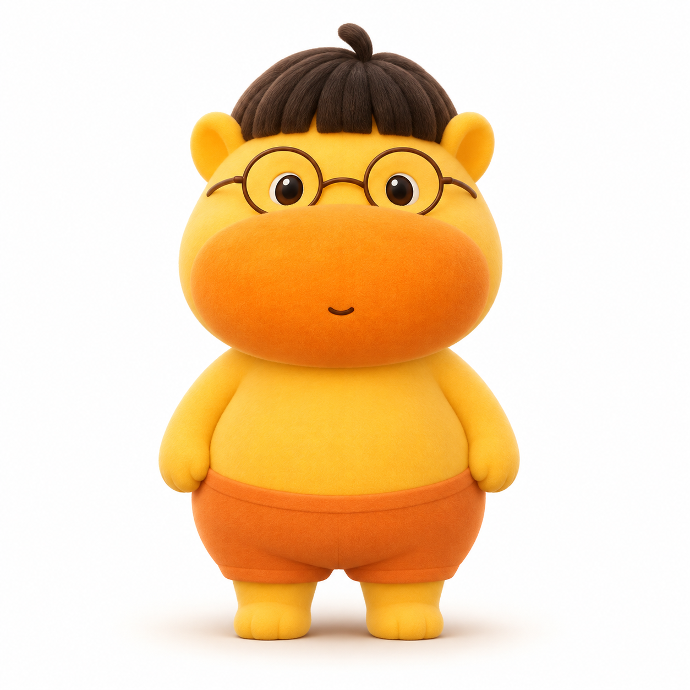

<div align="center">

# Meow · 张噜噜

**住在桌面上的毛绒小伙伴：陪你聊天，用表情和动作回应，也记得你的日常。**



张噜噜角色参考图 · 桌面表现由独立动画素材驱动

**Windows x64 · C# / WPF · .NET 10**

[快速开始](#快速开始) · [从源码构建](#从源码构建) · [Windows 说明](docs/WINDOWS.md) · [macOS 原版](docs/MACOS.md)

</div>

本仓库在 Meow 原版基础上继续开发，当前主要迭代 Windows 桌面角色「张噜噜」。macOS 的 Swift 客户端「高小喵」及原有功能独立保留，两端使用不同的界面和动画实现。

## 能做什么

| 功能 | 当前体验 |
| --- | --- |
| 桌面陪伴 | 拖动、抛出、抚摸、走走停停、窗口停留，以及精力、饥饿和心情变化 |
| 聊天与行为 | 流式中文对话；根据对话选择表情和动作，明确口令可直接触发互动 |
| 动作与表情 | 挥手、点头、摇头、伸懒腰、跳舞、转圈、打滚、吃西瓜、玩球，以及开心、害羞、好奇、生气等表情 |
| 睡觉与唤醒 | 走到睡铺、上床盖被、睡眠呼吸、唤醒和离床返回；睡眠等持续状态保持到被明确打断 |
| 扶边探头 | 拖到屏幕左右边缘后，切换专属扶边、呼吸和眨眼动画；鼠标靠近时轻轻探出 |
| 小本本 | 保存主人资料和共同经历，支持查看、修正和删除记忆 |
| 备忘录 | 手动或通过对话管理待办，提供到点提醒与可选的提前提醒 |
| 热点小报 | 获取微博热点，按偏好选题，并可定时分享 |
| 噜噜信箱 | 与绑定设备互寄文本信件，支持待寄重试、回执与未读提醒 |
| 多模型接入 | 多家云端服务商、自定义 OpenAI 兼容接口，以及可选本地模型 |

角色采用透明序列帧播放，已接入高清图集、背景清理和动作过渡。`prototypes/lulu-rig/` 是保留的 3D 骨骼实验，尚未用于桌面客户端。最新素材与已知衔接问题记录在[动画体验与修订记录](docs/LULU-RUNTIME-PREVIEW.md)。

## 快速开始

### Windows 安装与启动

目标环境为 **Windows 10（2004 或更新版本）/ Windows 11，x64**。安装包包含 .NET 运行环境；缺少 Visual C++ 运行库时，会调用随附的微软安装程序。

如果已获得 `Meow-<版本>-Windows-x64-Setup.exe`：

1. 从噜噜右键菜单退出旧版本，再运行安装程序。
2. 按向导安装；完整包可包含轻量本地模型，只用云端 API 时可选择精简组件。
3. 双击桌面或开始菜单中的 **Meow · 张噜噜**。
4. 右键角色 → **设置**，配置对话模型，测试成功后保存。

安装包由[打包脚本](scripts/package_windows_installer.ps1)生成，构建输出不包含在 Git 源码中；尚未拿到安装包时，请使用下方源码构建流程。安装位置、组件和验证范围见 [Windows 安装包说明](docs/WINDOWS-INSTALLER.md)。当前体验包尚未配置代码签名。

### 日常操作

| 操作 | 效果 |
| --- | --- |
| 双击噜噜 | 打开聊天；有未读来信时进入信箱 |
| 右键噜噜 | 打开设置、动作、表情、喂食、玩耍和睡觉等入口 |
| 拖动后松开 | 移动或抛出角色 |
| 鼠标在身体上移动 | 抚摸互动 |
| 拖到屏幕左侧或右侧 | 进入扶边探头状态 |
| 拖离边缘，或选择移动动作 | 返回桌面活动 |

可以直接说「挥挥手」「去睡觉吧」「醒醒」「散步一会儿」「停下来」，也可以说「保持开心，直到我叫停」。普通聊天会适度触发表情，持续状态不会被每次普通回复自动清除。一次性的吃瓜、玩球等动作不会无限重复。

## 对话模型设置

设置中提供以下服务商选项：

- OpenAI / GPT、Anthropic / Claude、Google / Gemini。
- 豆包 / 火山方舟、DeepSeek、通义千问 / 百炼、Kimi、GLM、MiniMax。
- xAI / Grok、硅基流动、OpenRouter，以及自定义 OpenAI 兼容接口。

选择服务商后，填写 **Base URL、模型名称或推理接入点 ID、API Key**，点击「测试连接」，成功后再「保存模型设置」。模型名称应使用该账号实际可调用的文本模型 ID；各服务商分别保存配置。详细地址和接口适配方式见 [Windows 模型设置](docs/WINDOWS.md#模型-api-设置)。

本地模式可使用随附的 **llama.cpp + Qwen2.5-0.5B-Instruct Q4_K_M**，也可连接其他本机 OpenAI 兼容服务。轻量模型适合简单对话；自动记忆整理、热点选题和智能提醒等后台功能仍按设置使用云端服务。

基础动作不需要 API Key。云端聊天及智能功能会向所配置的服务发起请求，模型可用性与额度由服务商账号决定。

## 从源码构建

### Windows

准备 **Git、PowerShell 7、.NET 10 SDK、Node.js 20.3 或更新版本**，并能访问 NuGet 和 npm 依赖源。该仓库为私有仓库，克隆时需使用有访问权限的 GitHub 账号。

在 PowerShell 7 中执行：

```powershell
git clone https://github.com/zsw20001005/Meow.git
cd Meow

# 准备 Node / iroh 信箱组件
./scripts/prepare_windows_mail.ps1

# 构建包含 .NET 运行时的桌面版
./scripts/package_windows.ps1 -SelfContained

# 启动
./build/Meow-Windows-x64/Meow.exe
```

输出目录为 `build/Meow-Windows-x64/`，使用或分发时应保留整个目录。角色图集已在仓库中，普通构建无需重新生成视频。编译工具、依赖缓存、模型权重和构建产物由本机准备。

如需随程序携带本地模型，在上述依赖准备完成后执行：

```powershell
./scripts/prepare_windows_local.ps1
./scripts/package_windows.ps1 -SelfContained -IncludeLocalModel
```

制作带安装向导的 `.exe` 还需要 Inno Setup、图标和相应运行库、许可证文件，完整步骤见 [Windows 安装包说明](docs/WINDOWS-INSTALLER.md)。

更新源码后需重新构建，并退出旧进程后启动新版。Windows 客户端采用单实例运行，直接启动另一份 EXE 可能仍打开正在运行的旧版。

### macOS

macOS 原版使用 **Swift / SwiftUI**，目标为 Apple Silicon、macOS 14.4 或更新版本。原版造型、云端与 MLX 本地模型、钥匙串及安装磁盘的说明已移至 [macOS 原版指南](docs/MACOS.md)。

## 数据与隐私

| 内容 | Windows 存储或发送方式 |
| --- | --- |
| 设置、聊天、记忆、备忘录和角色状态 | `%LOCALAPPDATA%/Meow.Windows/`，主存档为 `state.json` |
| 模型密钥与信箱私钥 | 使用当前 Windows 账号的 DPAPI 加密后保存 |
| 云端聊天与智能功能 | 按功能需要发送对话、相关记忆或任务到所选模型服务 |
| 热点小报 | 访问微博，并按设置调用模型选题 |
| 信箱 | 与绑定设备通信，使用 iroh 发现或中继服务；正文不提交给模型 |

普通业务数据保存在本机，不是全部加密存储。源码不包含开发者的 API Key、聊天记录或信箱身份；克隆仓库不会同步个人存档。安装升级复用原存档，卸载保留存档。

信箱需双方各绑定一次对方设备码，双方在线并运行应用时才能完成传递；待寄队列保存在发送端，没有服务器代收。跨平台、跨网络互通仍需实机验收。

需要离线使用时，选择本地模型，并关闭热点、信箱及相关云端后台功能。备忘录提醒需要应用运行，退出或休眠期间不会按时弹出。

## 开发与检查

常用离线检查可通过构建后的程序运行。下面的命令会等待检查结束并检查退出码：

```powershell
$exe = (Resolve-Path ./build/Meow-Windows-x64/Meow.exe).Path
foreach ($check in @('--selftest', '--animationcheck', '--conversationcheck', '--edgecheck')) {
    $process = Start-Process -FilePath $exe -ArgumentList $check -Wait -PassThru
    if ($process.ExitCode -ne 0) { throw "检查失败：$check" }
}
```

睡铺接点和散步另有 `--bed-entrycheck`、`--strollcheck`；`--character-preview`、`--bed-preview` 用于独立预览。网络信箱与真实云端调用的检查见 [Windows 开发说明](docs/WINDOWS.md#验证)。离线检查通过不等于所有设备上的视觉效果和网络互通都已验收。

```text
windows/
  Meow.Windows/           WPF 客户端、对话行为、状态与动画播放
    Assets/Lulu/Video/    常规动作和表情图集
    Assets/Lulu/Bed/      睡铺动作及过渡
    Assets/Lulu/Edge/     扶边探头循环
  Meow.MailBridge/        Node / iroh 通信桥
  installer/             Windows 安装向导配置
Sources/                 macOS Swift 客户端与业务模块
Tests/                   macOS 测试
scripts/                 构建、素材处理、检查和打包脚本
docs/                    使用说明、设计与验证记录
prototypes/lulu-rig/     未接入桌面的 3D 骨骼实验
```

## 致谢与许可

本项目基于 [Kokosuki](https://github.com/Fangyuan025/Kokosuki) 和 [Meow 原版](https://github.com/BryanGao-1216/Meow) 继续开发。Windows 使用 WPF、OpenCvSharp、llama.cpp 和 iroh；macOS 原版使用 SwiftUI、MLX Swift 与 iroh-ffi。记忆与提醒设计亦参考 mem0、Mochi 等项目。

代码沿用 [MIT 许可证](LICENSE)，保留原作者版权声明。第三方依赖、模型及素材需按各自适用的许可与使用条件处理。
